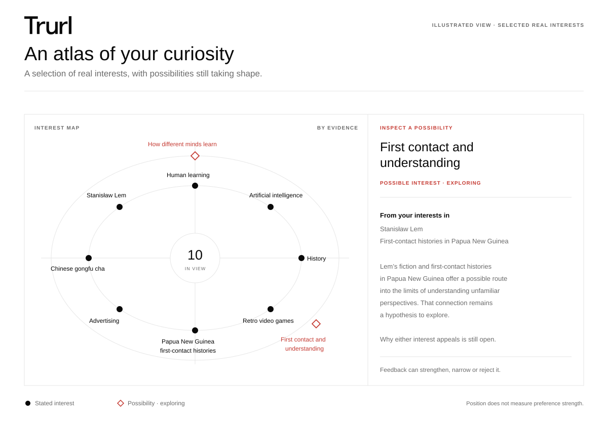
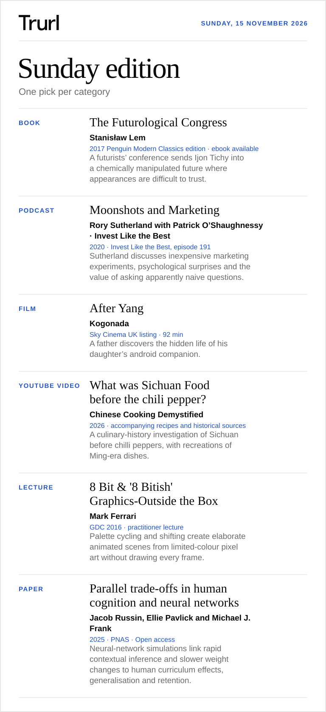
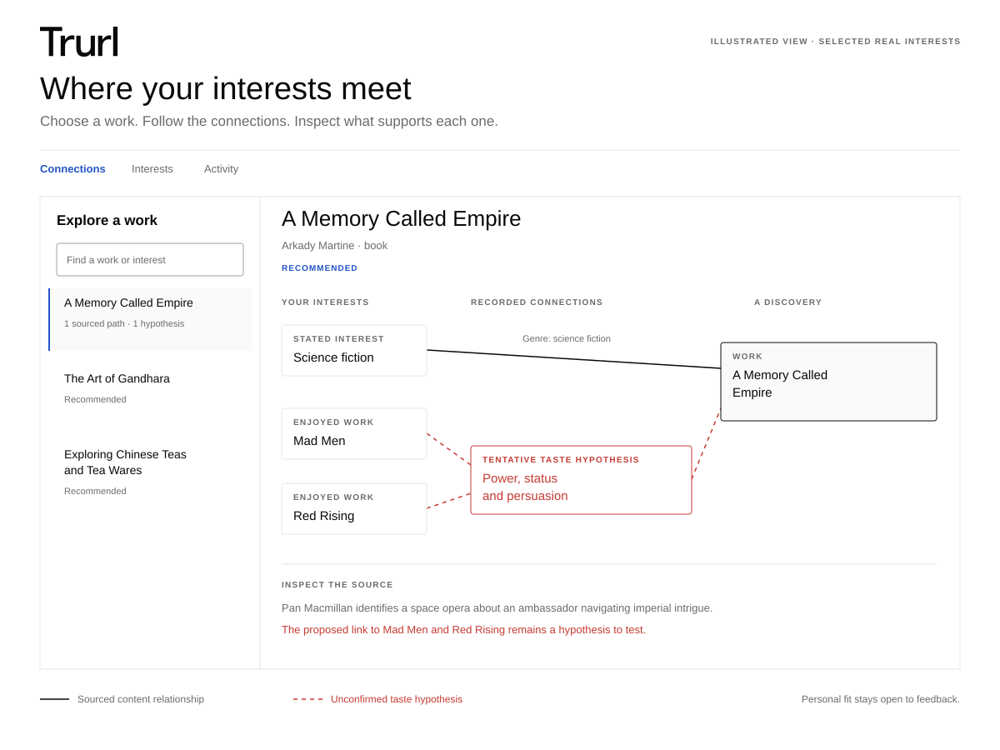

<h1 align="center">
  <picture>
    <source media="(prefers-color-scheme: dark)" srcset="skills/trurl/assets/trurl-wordmark-inverse.svg">
    
  </picture>
</h1>

<h3 align="center">Your agent, your taste.</h3>

<p align="center">
  Turn your agent into a personal curator aligned to your interests, tastes and explorations.<br>
  It finds books, films, podcasts, videos, lectures and scientific papers, and discovers diamonds in the rough.
</p>

<p align="center">
  <a href="#get-started">Get started</a> · <a href="#try-asking">Try asking</a> · <a href="#sunday-edition">Sunday edition</a> · <a href="#see-your-taste-atlas">Taste Atlas</a> · <a href="#how-it-learns">How it learns</a> · <a href="#the-research-behind-trurl">Research</a>
</p>

Trurl proactively builds a taste model that grows with you, in plain files you own. It draws on what you share: your interests, what you've already encountered and what you've enjoyed. You can start with one curiosity, but a whole brain dump and memory will produce the best results. Come back for a film tonight, a deeper read or a direction you haven't explored before. Trurl uses seeded variation to explore different research directions and move beyond the same familiar recommendations. It is designed to counter **mode collapse** an agent's tendency to converge on predictable answers. It does that by broadening the search before checking each pick against your interests, constraints and reliable sources.

<p align="center">
  <a href="assets/readme-discovery-20261109/atlas-interests-example.svg"></a>
  <br>
  <sub>Illustrated view of selected real interests and tentative possibilities. Positions organise the view; they do not measure preference strength.</sub>
</p>

- **Discover new fields.** Trurl connects interests you already have, forms hypotheses about what else you might enjoy, and uses your feedback to refine future picks.
- **Get straight to the work.** A title, creator, link and short description. Ask for the reasoning when you want it.
- **Have something to look forward to.** A designed Sunday edition with one pick in each category you choose.
- **Pick up where you left off.** Your profile and feedback carry across conversations with access to the same private folder.

## Get started

Install Trurl as a skill in **Claude Code, Codex or Pi**. You need Python 3.9 or later. Clone this repository and install Trurl for the agent you use.

```sh
git clone https://github.com/oblomovunleashed/trurl.git
cd trurl
python3 trurl.py install --agent claude-code
```

Then start a new session and invoke Trurl. New local models live in `~/Trurl/model` by default, ready to reuse across sessions. Give it a category and something you’re curious about.

```text
/trurl Books and films, please. Lately I'm curious about how maps shape what we see.
```

Trurl starts building your taste profile and gives you a first selection. A category and one thing you like are enough. You can also use your app’s voice input to dictate a brain dump, or paste as much as you like about books, films, podcasts, topics and interests. It shows you a short profile you can correct as you go.

You choose whether it can use relevant agent memory. Reviewing past chats is a separate choice. What you share here is enough to get started.

<details>
<summary>Example of a dictated brain dump</summary>

> A mix of everything, please. Use only what I share here.
>
> I love science fiction. Stanisław Lem, *The Hitchhiker’s Guide to the Galaxy*, *Roadside Picnic* and *Project Hail Mary* are good starting points. I love Russian classics too, especially Gogol, Dostoevsky and *Oblomov*. I’m also interested in the Roman Empire and Alexander the Great.
>
> I make a podcast and I like to write. I listen to the *Dwarkesh Podcast*, *Invest Like the Best* and *No Priors*. I’m especially curious about how people learn and how AI models work.
>
> I’m into Chinese tea, especially gongfu brewing, and I love to cook, particularly Asian food. I love Anthony Bourdain’s writing and shows. I’m into memes too, and I like reading children’s stories with my kids.

</details>

Using another agent? Swap the install selector and invoke Trurl with that agent’s prefix.

| Agent | Install selector | Invoke Trurl |
| --- | --- | --- |
| Claude Code | `--agent claude-code` | `/trurl` |
| Codex | `--agent codex` | `$trurl` |
| Pi | `--agent pi` | `/skill:trurl` |

Your agent provides the research tools, file access and any scheduling. Trurl supplies the curation workflow and Python helpers. Pi's default coding tools do not supply a research service, personal memory service or scheduler; those capabilities depend on your setup. [Host setup and capability checks](docs/HOSTS.md)

To update later, pull this repository and run the install command again with `--update`. Your taste model is kept.

<details>
<summary>Choose or check where your taste model lives</summary>

Onboarding shows the selected folder. An existing workspace model or an explicitly chosen root takes precedence over the default. You can inspect the location yourself and initialise a new profile if needed.

```sh
python3 trurl.py root
python3 trurl.py init
```

For an existing model elsewhere, remember its root:

```sh
python3 trurl.py use --root "/absolute/path/to/curation-root"
```

Use `init --root /absolute/path` first if you need to create a model in a custom folder. Later sessions and agents can reuse it when they have access to the same filesystem and user configuration. Remote and sandboxed hosts need access to persistent storage; the skill does not sync files between devices. [Storage and migration](skills/trurl/references/onboarding.md#choose-a-lasting-home)

</details>

[Onboarding](skills/trurl/references/onboarding.md) · [OpenAI dots and Claude Duet](docs/HOSTS.md#openai-dots-and-claude-duet) · [Troubleshooting](docs/TROUBLESHOOTING.md)

## Try asking

Use your agent’s [Trurl prefix](#get-started), then ask in your own words.

**Find something now**

- “A funny film under 90 minutes. Nothing grim.”
- “I have 20 minutes. Find me one video about animal senses.”
- “One paper on how sleep affects memory, with free full text.”
- “Three things to read before bed to change my perspective on China.”
- “Surprise me with a book connected to something I like.”

**Steer the next pick**

- “I’ve read that one. Give me something with the same feel.”
- “I liked how that explained a difficult idea through a story. Remember that for next time.”
- “Why that one?”
- “What have you picked up about my taste?”
- “Show me my taste atlas.”
- “Use only what I share here.”

**Make a Sunday edition**

- “Make me a Sunday edition with a book, a film and a podcast.”
- “Make this week’s edition books and films.”
- “Move my Sunday edition to 6 pm.”
- “Turn off Sunday delivery.”

## Sunday edition

Choose your categories and get one verified pick in each. This preview was prepared on **9 November 2026** for **Sunday, 15 November**. It brings together Lem’s satire, marketing experiments, an android’s hidden life, Sichuan food history, pixel-art animation and human learning.

| Format | Pick | Creator |
| --- | --- | --- |
| Book | [The Futurological Congress](https://www.penguin.co.uk/books/305868/the-futurological-congress-by-lem-stanislaw/9780241312797) | Stanisław Lem |
| Podcast | [Moonshots and Marketing](https://colossus.com/episode/sutherland-moonshots-and-marketing/) | Rory Sutherland · Invest Like the Best |
| Film | [After Yang](https://www.sky.com/watch/programme/fdd5b220-e3d1-4436-ab17-61ebdc34c9be) | Kogonada |
| YouTube video | [What was Sichuan Food before the chili pepper?](https://www.youtube.com/watch?v=tsuSylVVx2w) | Chinese Cooking Demystified |
| Lecture | [8 Bit & '8 Bitish' Graphics-Outside the Box](https://www.youtube.com/watch?v=aMcJ1Jvtef0) | Mark Ferrari |
| Paper | [Parallel trade-offs in human cognition and neural networks](https://pmc.ncbi.nlm.nih.gov/articles/PMC12415290/) | Jacob Russin, Ellie Pavlick and Michael J. Frank |

<p align="center">
  <a href="examples/sunday-2026-11-15/sunday-edition.md"></a>
  <br>
  <sub>Prepared on 9 November for Sunday, 15 November 2026. <a href="examples/sunday-2026-11-15/sunday-edition.md">Read the complete edition</a></sub>
</p>

Ask for an issue any time. First-time setup includes Sunday delivery at **8 pm local time** where your agent supports scheduling. You see the proposed schedule and can say “one-off only” before it starts. Once you continue setup, Trurl confirms whether the schedule is active. Each scheduled edition runs as an ordinary request on your plan. Say “turn off Sunday delivery” whenever you want to stop it. Existing profiles keep their delivery choice. [Sunday edition setup](skills/trurl/references/sunday-edition.md)

## See your taste atlas

See how a recommendation connects different parts of your taste.

Ask **“Show me my taste atlas”**, then choose a work in the **Connections** view. Follow its links to your interests through subjects and creators, and inspect the sources behind each relationship. Solid paths show sourced content relationships; dashed paths show the recorded recommendation rationale or a tentative taste hypothesis. The interest map and monthly suggestion and feedback history remain alongside it.

For the Lem and first-contact example above, the Atlas can show the proposed taste connection to *The Falling Sky* as a hypothesis, alongside the sourced facts about the book. You can see what is documented and what is still being explored.

The Atlas is a private, offline file generated from your current records when you ask. Current graph connections are separate from the reasons recorded when a work was recommended. Each current interest is represented automatically, including interests without a researched connection yet. The Atlas reports representation and sourced-route coverage separately, so gaps remain visible. It synchronises private mappings without changing your preferences or recommendation history. The reusable template ships with the skill for Codex, Claude Code and Pi.

<p align="center">
  <a href="assets/readme-discovery-20261109/atlas-connections-example.svg"></a>
  <br>
  <sub>A real connection to explore: science fiction, Mad Men and Red Rising. Solid lines show sourced content relationships; dashed lines show a tentative taste hypothesis.</sub>
</p>

## How it learns

Your Personal Intellectual & Taste Model starts with what you tell Trurl. It holds your interests, preferences, familiarity and feedback, with room for the quieter interests that might otherwise get lost in a conversation.

**Your profile carries the evidence.** Trurl keeps what you said you like, what it suggested and how you responded as distinct records. “I'd try that” stays different from “I loved it.” Your feedback can be as simple as saying what stayed with you; ratings are optional.

**The curator’s brief gives the agent a working understanding.** It draws together the useful patterns in a short summary, checked against the records behind it. Correct the profile and the brief needs to catch up before it can be used again. You can ask to read or correct it at any time. [How the brief works](skills/trurl/references/curators-brief.md)

**Today's request sets today's priorities.** A film for a tired evening calls for a different selection from a weekend of reading. The request plan handles format, time, mood and how far to explore. “Further away this time” changes that selection while keeping your lasting preferences intact.


### How it finds new fields

Trurl can suggest a field you haven’t thought to ask about. It actively reviews possible new interests after setup, when your interests or feedback change, and when broad discovery needs fresh possibilities. It looks within individual interests and across pairs of them, forming a tentative hypothesis about what else might appeal.

<p align="center">
  
  <br>
  <sub>A few curiosities. An unexpected direction.</sub>
</p>

For example, liking Stanisław Lem and being curious about first-contact histories in Papua New Guinea might suggest an interest in how encounters challenge our assumptions. Trurl could test that idea with [*The Falling Sky*](https://www.jstor.org/stable/j.ctv34dm7q2) by Davi Kopenawa and Bruce Albert, an account of encounters with outsiders from a Yanomami perspective in the Amazon. The proposed connection concerns the limits of understanding; whether it explains your taste remains a hypothesis.

After researching recommendations, Trurl saves a small set of verified relationships between works, subjects and creators, with their sources attached. Each run records whether it added or revised facts, or found no supported changes. Here, the graph retains the book’s documented subject and authors, while the proposed connection to your enjoyment of Lem stays tentative in the taste model.

When a sourced content graph is available, Trurl can also find different interests leading to the same subject. It keeps a few of these converging routes as research leads; they do not automatically increase confidence about your taste. On a broad request, it can explore one promising connection through a recommendation that fits your constraints.

Feedback you choose to share helps it strengthen, narrow or reject the hypothesis and adjust what it looks for next. One enjoyed work leaves the broader idea tentative; clear confirmation or a pattern of enjoyment can establish a supported interest. That gives future recommendations a richer starting point, with each new connection grounded in your reactions. You can inspect and correct these hypotheses at any time. [How taste hypotheses work](skills/trurl/references/taste-hypotheses.md)

For broader selections, seeded variation can change the research angles and the balance of priorities, helping Trurl look beyond the same few leads. Your requested format, time limits and exclusions still apply. Focused requests stay focused.

## Your taste model is yours

- **A lasting local home.** Your model lives outside the installed skill, in `~/Trurl/model` unless you choose another persistent folder. Onboarding tells you where it is saved.
- **Plain files you own.** Your profile, suggestion history, feedback, curator’s brief, content graph and maintenance records live in a private folder you can read, edit or delete. [State contract](skills/trurl/references/state-contract.md) · [Starter profile](examples/profile.example.json)
- **You choose its sources.** It works from what you tell it. Using the agent’s memory or past chats is a separate choice, and you can say no.
- **Take it with you.** Point another supported agent at the same folder, if it can reach it, and carry on. Keep the `model/` folder private when you share the skill.

## The research behind Trurl

- **Broaden the search before ranking.** The agent starts with different leads, such as a museum archive for the history, a practitioner’s account or a paper on how something works. This borrows from research on getting models to propose a wider range of answers. [Verbalized Sampling](https://arxiv.org/abs/2510.01171)
- **Use seeds to vary the search.** Research on seed prompts helped inspire this. Trurl uses Python for the draws, varying research directions and, on some requests, how much weight it gives to depth or novelty. With the same inputs, you can replay those draws. [String Seed of Thought](https://arxiv.org/abs/2510.21150) · [Large Language Models Are Bad Dice Players](https://arxiv.org/abs/2601.05414)
- **Follow connections you can check.** An optional knowledge graph gives the agent short, sourced paths between works, topics and creators. Each path gives it a lead to investigate. [Knowledge graph path reasoning](https://arxiv.org/abs/1906.05237)
- **Keep suggestions separate from taste.** Trurl keeps a record of what it recommended separately from what you say you liked. A coverage audit can show when the same subjects or creators keep turning up. [Recommendation feedback loops](https://arxiv.org/pdf/1710.11214) · [The Basic B\*\*\* Effect](https://arxiv.org/abs/2509.02910)

These studies inform the design. The notes explain what the studies tested and how to evaluate Trurl’s selections. [Research notes](docs/SCIENTIFIC_BASIS.md) · [Graph research](docs/GRAPH_RESEARCH.md)

<details>
<summary>How Trurl plans a selection</summary>

Trurl uses your taste model and current request to set priorities. The agent looks in several directions, checks the works against your constraints, and uses the history to check for repeats. An optional content graph helps it follow sourced connections between works, topics and creators.

Cross-theme research reuses an existing exploration opportunity. Its brief includes at most one compact supporting interest, and graph discovery adds at most two alternate routes. Hypothesis summaries refer back to original records without copying their feedback history.

Hypothesis maintenance remembers the evidence it last reviewed, so unchanged requests reuse that work. Each review records a saved hypothesis, confirms that the existing pool is useful, or explains why no sound proposal emerged. It runs within the current curation request, adds at most one proposal and needs no separate model call or background job. A delivered suggestion is an opportunity used, never evidence that you liked it.

Graph updates reuse sources already checked during the request and return a compact completion record. Local interest mapping runs automatically during discovery and Atlas refreshes, reusing unchanged work without another model call. They save small deltas, deduplicate existing facts and reuse unchanged work; the full graph does not need to be copied into each request. A relationship between a work and a subject never establishes that you like it.

Try the planner and discovery helpers with synthetic inputs.

```sh
python3 trurl.py demo --format table --seed 42
python3 trurl.py explore --plan examples/surprise-plan.json --profile examples/profile.demo.json --seed 1701 --count 5
python3 trurl.py graph-check --graph examples/graph.example.json
python3 trurl.py frontier --graph examples/graph.example.json --profile examples/profile.graph-demo.json --seed 1701 --count 5
```

The `explore` command prints [this example output](examples/exploration-plan.json).

Your agent uses its research tools to verify real recommendations. To inspect the weights for a request using your own model, run the planner. It finds your model the same way a session does.

```sh
python3 trurl.py weights --request "surprise me" --seed 42
```

[Adaptive weights](skills/trurl/references/adaptive-weights.md) · [Discovery workflow](skills/trurl/references/diverse-discovery.md) · [Knowledge graph](skills/trurl/references/knowledge-graph.md)

</details>

[Skill instructions](skills/trurl/SKILL.md) · [Development and tests](docs/DEVELOPMENT.md) · [Brand assets](skills/trurl/references/visual-identity.md) · [MIT licence](LICENSE)
